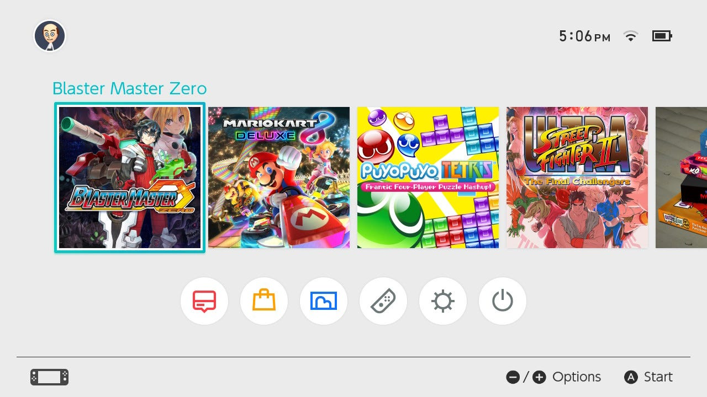
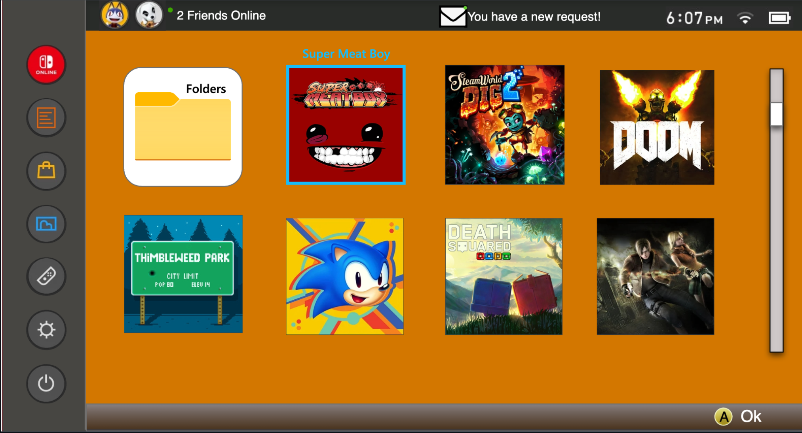

#Nintendo Switch Redesign

A group redesign of the Nintendo Switch software and hardware, created for a Human Computer Interaction class

**#Original Home Screen**

**#Redesigned Home Screen**

Overview

Course: Human Computer Interaction at the University of Michigan-Flint
Timeline: Winter 2024
Team: 3 students
My role: I wrote the individual usability evaluation report, conducted usability reports, designed prototype mockups, and created story boards
Tools: Adobe XD and OTHER TOOLS
Links: ADD LINKS TO THE PROTOTYPE, PRESENTATION, AND REPORT

##The Problem
Our team found that the Nintendo Switch has several usability and comfort issues. The screen felt too small for some users, and some icons were hard to understand and follow. Older users in particular could struggle to move between pages. The controllers felt too small for some users, and the system offered very few options to customize the experience. These issues made the Switch less comfortable and less accessible for a wide range of players.

Methods

We used usability interviews, representative tasks, think aloud testing, heuristic evaluation, and prototyping from low to high fidelity

##The Four Phases
Phase 1: Study Planning: Defined the system, representative tasks, interview questions, and participant script

Phase 2: User Research and Modeling: Interviewed participants and built artifact, flow, and social models plus a list of dos and don'ts

Phase 3: Redesign: Sketched individual redesigns, combined them into a final design, and storyboarded how users would complete the tasks

Phase 4: Usability Evaluation: Wrote the group usability evaluation report

##Key Findings

FINDING 1: Users expressed that having a bigger controller would better help with making quick movements and navigation.
FINDING 2: Users expressed having customization options to give more personality and options to their menu page.
FINDING 3: Users felt that the kickstand and memory card locations were hard to find.
FINDING 4: Nintendo Eshop navigation was hard to follow as some key terms wouldn't show up for some users.
FINDING 5: Search options had to be specific in order to find results as with the news channel.
FINDING 6: SOme users expressed that adding lighting to the controls would better help with controller use as well.

##Results
Our research led us to redesign most of the system around what participants told us. Users wanted a bigger controller to help with quick movements and navigation, so we enlarged the controllers in our hardware redesign. They asked for customization options to give their menu page more personality, so we added ways to personalize it. They found the kickstand and memory card locations hard to find, so we made them easier to locate. The Nintendo eShop was hard to follow because some key terms did not show up for some users, and search results required very specific terms, as with the news channel, so we redesigned the navigation and search to be easier to use. Some users also suggested lighting on the controls to make the controller easier to use, which we added to our design.

##My Contribution
I wrote our individual usability evaluation report, where I evaluated the original Nintendo Switch using methods, such as think aloud testing. 

On the hardware side, I found that the buttons and joysticks on the Joy-Cons were hard to use for specific movements, especially for people with larger hands. I recommended increasing the joystick and button size so each button is easier to identify and use. Another was the placement of the memory card behind the kickstand which raised concerns for me on whether the card slot being open could increase chances of damage to it if dropped or something was spilled. Furthermore if the kickstand were to break you would have an exposed memory card slot you could do nothing to hide it with.

On the software side, I found that navigating applications like the eShop and News Channel was complicated because searches required specific terms instead of broad keywords. I found that when looking up specific games that were in a bundle, that game would not show up and make me think the game was never purchasable even though it technically is. 

##Reflection
This project showed me how much the structure of a design shapes the way people use technology. Watching participants complete the representative tasks during think aloud testing made it clear that something that seems obvious to a designer can be confusing to a real user, especially when icons are hard to follow or navigation takes too many steps. Hearing how participants of different ages and comfort levels used the Switch also helped me see why accessibility and customization matter.

Working through each phase taught me the value of building on evidence. Our interviews, models, and usability findings guided our sketches and final design, so our decisions came from what we observed and not from personal preference. Working in a group also showed me how combining individual redesigns leads to stronger ideas than any one of us would have had alone.

If I did this project again, I would test with more participants, include more wider age group of users, or run a second round of testing on the final prototype. This project made me more interested in designing technology that is easy and comfortable for everyone to use. Even though this project was created in 2024 many of the design aspects in our prototypes, evaluations made by our participants, and other concepts were reflected in the design choices made by the Nintendo Switch 2 which was released in 2025. This showed me that testing with real users can uncover the same problems that professional design teams find.

##Disclaimer

This is an independent class project and is not affiliated with Nintendo. Nintendo Switch and related trademarks belong to Nintendo
